# Aegis-SOAR: Automated Incident Response Orchestration Platform ⚡🛡️

**Security Orchestration, Automation & Response (SOAR) Playbooks for Phishing Triage and Honeypot Brute-Force Containment**  
*Engineered by [Vasilis Tsiamouras](https://www.linkedin.com/in/vasilis-tsiamouras/)*

[](https://www.python.org/)
[](https://tines.com)
[](https://github.com/Shuffle/Shuffle)
[](https://thehive-project.org/)
[](https://opensource.org/licenses/MIT)

---

## 📌 Executive Summary

Modern enterprise Security Operations Centers (SOCs) are overwhelmed by alert volume. A top-tier Security Engineer or SOC Analyst must prove they can automate manual triage toil, coordinate threat intelligence lookups, and execute **immediate automated containment actions** (quarantine, credential revocation, and perimeter firewall blocking).

**Aegis-SOAR** is an end-to-end incident response orchestration platform featuring:
1. **Automated Phishing & Credential Harvester Triage:** Parses suspicious inbound emails, queries multi-engine threat intelligence, automatically terminates compromised user SSO sessions in Okta, sinkholes malicious domains, and dispatches interactive Slack alerts.
2. **Honeypot & SSH Brute-Force Auto-Isolation:** Ingests alerts directly from our **ShadowPot** honeypot or Wazuh SIEM, queries AbuseIPDB reputation, and dynamically applies perimeter `iptables DROP` rules to neutralize botnets.
3. **Turnkey Exportable Playbooks:** Pre-built workflow templates for both **Tines** and **Shuffle**.
4. **Standalone Orchestration Engine & Real-Time Dashboard:** A local FastAPI engine and web UI with DAG pipeline visualization and execution audit logging.

---

## 🏗️ Incident Workflow Architecture

```mermaid
sequenceDiagram
    autonumber
    actor Attacker as Threat Actor / Botnet
    participant Sensor as Detection Sensor (Email / ShadowPot)
    participant SOAR as Aegis-SOAR Engine
    participant Intel as Threat Intel (VirusTotal / AbuseIPDB)
    participant Identity as Identity Provider (Okta / AD)
    participant Firewall as Perimeter Firewall (iptables / WAF)
    participant Comms as Case Mgmt & Comms (TheHive / Slack)

    Attacker->>Sensor: Sends Phishing Link / Inbounds SSH Brute Force
    Sensor->>SOAR: Ingest Alert Webhook (POST /api/v1/alerts/webhook)
    SOAR->>Intel: Query IOC Reputation (URL / Attacker IP)
    Intel-->>SOAR: Return Verdict (Confidence Score > 75% | Malicious > 3)
    
    rect rgb(30, 20, 30)
    Note over SOAR,Firewall: Automated Containment Phase (< 50ms)
    SOAR->>Identity: Revoke Active SSO Tokens & Sessions for Target User
    SOAR->>Firewall: Inject Ingress DROP Rule / Sinkhole Malicious Domain
    end

    SOAR->>Comms: Create SEV-1 Incident Case in TheHive
    SOAR->>Comms: Dispatch Slack Alert with Interactive "Approve Quarantine" Buttons
```



---

## ⚡ Integrated Enterprise Playbooks

### Playbook 1: Phishing Credential Harvester Investigation & Containment
- **Trigger:** Webhook from secure email gateway or user-reported phishing button.
- **Enrichment:** Extracts URLs and file hashes, checking against 89 antivirus/threat feeds.
- **Automated Actions:**
  - Revokes active Okta / Active Directory tokens to prevent lateral movement.
  - Adds malicious URL/domain to enterprise DNS sinkhole.
  - Blocks sender IP on firewall.
  - Automatically logs case in TheHive with full IOC audit trail.
  - Posts interactive alert to Slack `#soc-incidents`.

### Playbook 2: ShadowPot / Wazuh Attacker Auto-Isolation
- **Trigger:** High-frequency failed authentication or compromise alert from honeypot.
- **Enrichment:** Queries AbuseIPDB for historical reporting and ASN reputation.
- **Automated Actions:**
  - If confidence score $\ge 75\%$ or attempts $\ge 5$, dynamically applies `iptables -I INPUT -s <IP> -j DROP`.
  - Dispatches emergency alert to SecOps.

---

## 📁 Repository Structure

```
soar-incident-response/
├── README.md                          # Production-grade project documentation
├── requirements.txt                   # Dependencies (FastAPI, Uvicorn, Rich, Requests)
├── config.yaml                        # Thresholds, API keys & driver configurations
├── run_soar.py                        # Master CLI simulation runner & web server launcher
├── engine/
│   ├── orchestrator.py                # Core DAG playbook execution engine
│   ├── server.py                      # Webhook listener (POST /api/v1/alerts/webhook)
│   └── integrations/                  # Modular enterprise integration drivers
│       ├── threat_intel.py            # VirusTotal & AbuseIPDB enrichment
│       ├── identity.py                # Okta / AD session revocation & account locking
│       ├── firewall.py                # iptables / Cloudflare WAF rule injection
│       ├── ticketing.py               # TheHive incident case tracking
│       └── notifier.py                # Slack webhook alert formatting
├── playbooks/
│   ├── tines_phishing_investigation.json    # Ready-to-import Tines Community Story
│   └── shuffle_honeypot_auto_ban.json       # Ready-to-import Shuffle Workflow
└── static/
    └── index.html                     # Real-time incident response web dashboard
```

---

## 🚀 Quickstart Guide

### 1. Installation

```bash
git clone https://github.com/Unskilled0ne/aegis-soar.git
cd aegis-soar

python3 -m venv venv
source venv/bin/activate
pip install -r requirements.txt
```

### 2. Run Automated CLI Incident Simulations

```bash
./run_soar.py --test
```
Simulates:
1. Critical Phishing attack targeting an enterprise user (triggers session revocation + firewall block).
2. Hostile SSH brute-force attack from known botnet (triggers automated iptables ban).
3. Benign corporate newsletter (analyzed, cleared, and logged without unnecessary containment).

### 3. Launch the Interactive Web Dashboard & Webhook Receiver

```bash
./run_soar.py --serve --port 8082
```
Access the dashboard at **`http://localhost:8082`** to:
- Monitor live DAG pipeline progression.
- Click simulation buttons to trigger live webhook incidents.
- View execution audit records, actions taken, and TheHive case IDs.

---

## 👤 Author

**Vasilis Tsiamouras**  
- LinkedIn: [linkedin.com/in/vasilis-tsiamouras](https://www.linkedin.com/in/vasilis-tsiamouras/)  
- Focus: Offensive Security, SecOps & Penetration Testing | University of Thessaly
